  

  
  &nbsp;
  

 

<h3 align="center">Sobre mim</h3>

  Desenvolvo aplicações web de ponta a ponta, do banco de dados à interface. 
  Gosto de código simples e bem organizado, e de transformar ideias em produtos que as pessoas realmente usam.

  💼 Software Engineer na <b>HOS Sistemas</b> &nbsp;·&nbsp; 🌱 estudando <b>cloud</b> &nbsp;·&nbsp; 🎯 foco em <b>full stack</b>

 

<h3 align="center">Ferramentas que uso hoje</h3>

  <b>FRONT-END</b> 
  

  <b>BACK-END E BANCO DE DADOS</b> 
  

  <b>DIA A DIA</b> 
  

 

<h3 align="center">Estudando no momento</h3>

  

  
  

 

  

